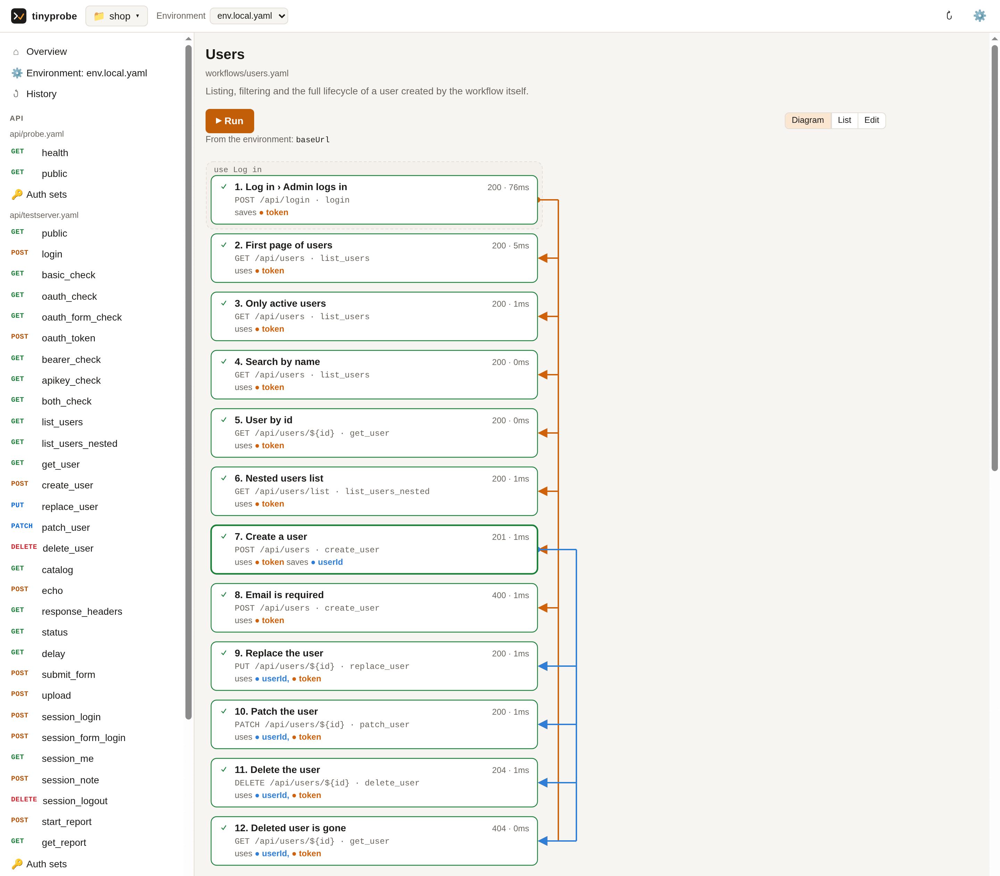
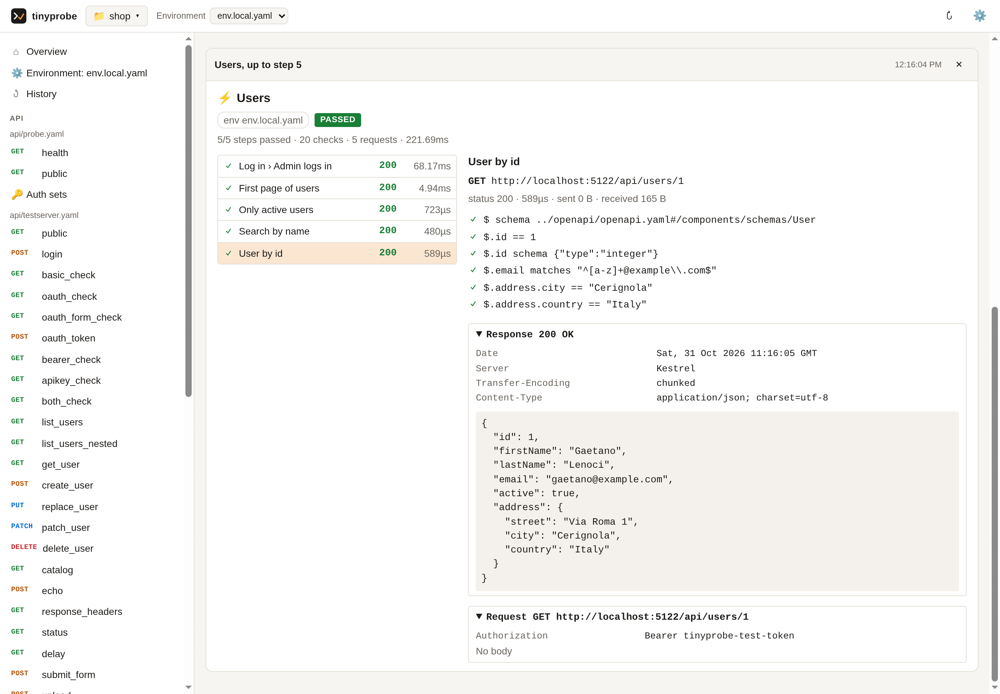
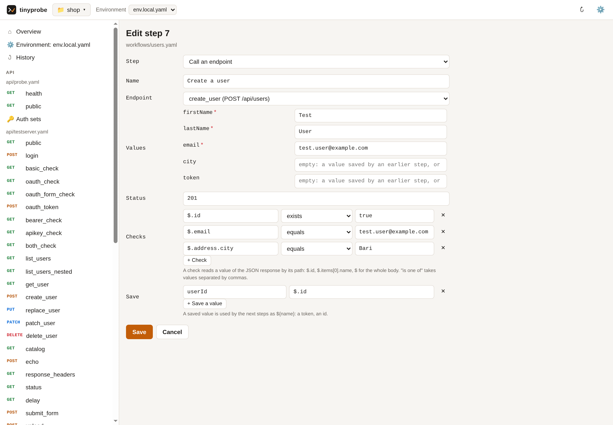

<p align="center"></p>

# tinyprobe-app

Call your API and run your tests from the browser, with no terminal and no editor. tinyprobe-app is the visual side of [tinyprobe](https://github.com/kikutano/tinyprobe): it opens the folder of your API tests, lets you send any request from a form, runs workflows and shows every request and response.

<p align="center">
  
</p>

- **One small download.** A 3.5 MB program for Windows, macOS or Linux, with nothing else to install: no account, no cloud, no Node, no .NET.
- **Your files, not a copy.** The app works on the YAML files of your folder. What you create here runs unchanged with `tinyprobe run` in a terminal and in CI, and what your team writes in an editor shows up here.
- **The same engine as CI.** Every request and every check is done by the `tinyprobe` program, so a workflow that passes here passes in your pipeline.

## Install

**Linux and macOS**, in a terminal:

```bash
curl -fsSL https://raw.githubusercontent.com/kikutano/tinyprobe-app/main/install.sh | sh
```

**Windows**, in PowerShell:

```powershell
irm https://raw.githubusercontent.com/kikutano/tinyprobe-app/main/install.ps1 | iex
```

One command does everything: it downloads the app, checks it against the release's checksums, adds the **tinyprobe** icon (Start menu and desktop on Windows, Applications on macOS, the applications menu on Linux), and downloads `tinyprobe` too if you do not have 0.20.0 or newer. Then start tinyprobe from its icon: a small window says the app is running, and the app opens in your browser. **Closing that window stops the app.** Run the same command again to update it.

### Or download it

1. Download the file for your computer from the [latest release](https://github.com/kikutano/tinyprobe-app/releases/latest):

   | Computer | File |
   |---|---|
   | Windows | `tinyprobe-app-win-x64.zip` |
   | Mac with Apple silicon | `tinyprobe-app-osx-arm64.tar.gz` |
   | Linux | `tinyprobe-app-linux-x64.tar.gz` (`linux-arm64` for ARM, `linux-musl-*` for Alpine) |

2. Unpack it and double-click `tinyprobe-app`. The first time, the page offers to download `tinyprobe` (about 4 MB, checked against its checksum) and to add the tinyprobe icon. After that, start it from the icon.

The app is not signed yet, so a downloaded file shows a warning at its first start (the install command above avoids it):

- **Windows**: "Windows protected your PC". Click **More info**, then **Run anyway**.
- **macOS**: "cannot be opened because the developer cannot be verified". Open **System Settings → Privacy & Security** and click **Open Anyway** next to tinyprobe-app, or right-click the file and choose **Open**.
- **Linux**: if a double-click does nothing, run `./tinyprobe-app` once in a terminal; then use the icon it adds.

In Chrome and Edge, **Install app** (in the address bar) gives tinyprobe its own window.

## What you can do

- **Open a folder**: usually the `tinyprobe/` folder of a project (opening the project opens it). Recent folders are one click away.
- **Send a request**: pick an endpoint, fill in its values and click **Send**. You see the status, the time, the response with its headers, and the request exactly as it was sent.
- **Run workflows**: a workflow is a test: steps that call endpoints, check the answers and pass values (a token, an id) from one step to the next. **Run** runs it, **Run to here** runs it up to a step and shows that step's response, **Run all workflows** runs the folder.
- **See how a workflow works**: its steps as a diagram, with a colored line for each value a step saves (a token, an id) down to the steps that use it, and what comes from the environment. It lights up as the workflow runs; click a step to see what it sends, checks and saves.
- **Pick and edit the environment**: the env file (`env.local.yaml`, `env.staging.yaml`...) with the base URL and the credentials. **Environment** lists its variables: change a value, add or delete one, and the file is rewritten line by line, its comments and order kept. Values whose name looks like a secret are hidden until you show them.
- **Look back**: **History** keeps the last 50 requests you sent, with their responses. Open one again, or send it again with the environment picked now. It is kept in the app's folder on your computer, not in your project, since requests carry credentials.
- **Edit without YAML**: **+ New request** writes a new endpoint into an API file, or starts a new one; **Edit** changes an endpoint; **Auth sets** adds a bearer token, an API key, Basic or OAuth2 to an API file; **+ New workflow** starts a test, and its **Edit** view adds, changes, moves and deletes steps (the endpoint, its values, the expected status, checks on the response, the values to save). Only the changed part of the file is rewritten, and tinyprobe checks the file before it is kept, so a form never leaves a broken file. What the forms do not cover (`until`, `for_each`, sequences, schema checks) is edited as YAML, one block at a time. Editing needs tinyprobe 0.21.0 or newer.

A request sent on its own remembers nothing for the next one. Values that go from one request to another are saved by a workflow, so every test says where its values come from and runs the same way everywhere.

<p align="center">
  
  
</p>

No tinyprobe files yet? Ask your coding agent to write them from your backend, a Postman collection or an OpenAPI document: the prompts are in the [tinyprobe README](https://github.com/kikutano/tinyprobe#generate-tests-with-a-coding-agent).

## Which tinyprobe it uses

The app needs tinyprobe 0.20.0 or newer. It uses the `tinyprobe` you installed yourself when it is new enough, otherwise its own copy, which it downloads from the [tinyprobe releases](https://github.com/kikutano/tinyprobe/releases) and updates from **Settings**. A tinyprobe on your `PATH` is yours to update (`tinyprobe update`).

## Security

The app sends requests with the credentials of your environment files and writes files, so nothing else on your computer may use it:

- it listens on `127.0.0.1` only: other computers cannot reach it;
- the page gets in through a one-time link that the app opens, which becomes a cookie no other web page can read or send;
- requests that do not come from the app's own page, or that name another host, are refused;
- it reads and writes files only inside the folders you opened.

Requests and responses are shown as they were sent, `Authorization` headers included. They stay in your browser: the app sends nothing anywhere except your own requests and, when you ask, the download of tinyprobe.

The app's settings are in `%LOCALAPPDATA%\tinyprobe-app` on Windows, `~/Library/Application Support/tinyprobe-app` on macOS and `~/.local/share/tinyprobe-app` on Linux.

## Command line

```text
tinyprobe-app [folder] [--port <n>] [--no-open]
tinyprobe-app --install
```

`folder` opens that folder; `--port` picks the port on `127.0.0.1` (the default is the last one used, first 4747); `--no-open` prints the link instead of opening the browser. `--install` is what the install commands run: it copies the app to its folder, adds the icon and downloads tinyprobe if needed. On Linux and macOS the install command also links `tinyprobe-app` in `~/.local/bin`.

## How it is built

A small launcher (C#, Native AOT, no ASP.NET) serves a page of plain HTML, JavaScript and CSS, with no framework and no build step, and runs `tinyprobe inspect`, `call` and `run`. The app is a client of tinyprobe: it reads only its public JSON protocol, and tinyprobe does not know the app exists ([decision 0004](https://github.com/kikutano/tinyprobe/blob/main/docs/decisions/0004-the-app-is-a-client-of-the-cli.md)). The design is in [spec 0017](https://github.com/kikutano/tinyprobe/blob/main/docs/specs/0017-app.md); the plan for this repository and tinyprobe is the tinyprobe [ROADMAP](https://github.com/kikutano/tinyprobe/blob/main/ROADMAP.md) (M5).

```bash
scripts/dev.sh check   # build, unit tests (dotnet and node), Native AOT, end-to-end, size and start-up budgets
scripts/dev.sh run     # start the app from the sources, with its settings in .dev/data
```

The end-to-end checks need `tinyprobe` and the tinyprobe repository next to this one (`../tinyprobe`), for its examples and test server. [CLAUDE.md](CLAUDE.md) maps the code.

## License

MIT. See [License.md](License.md).
